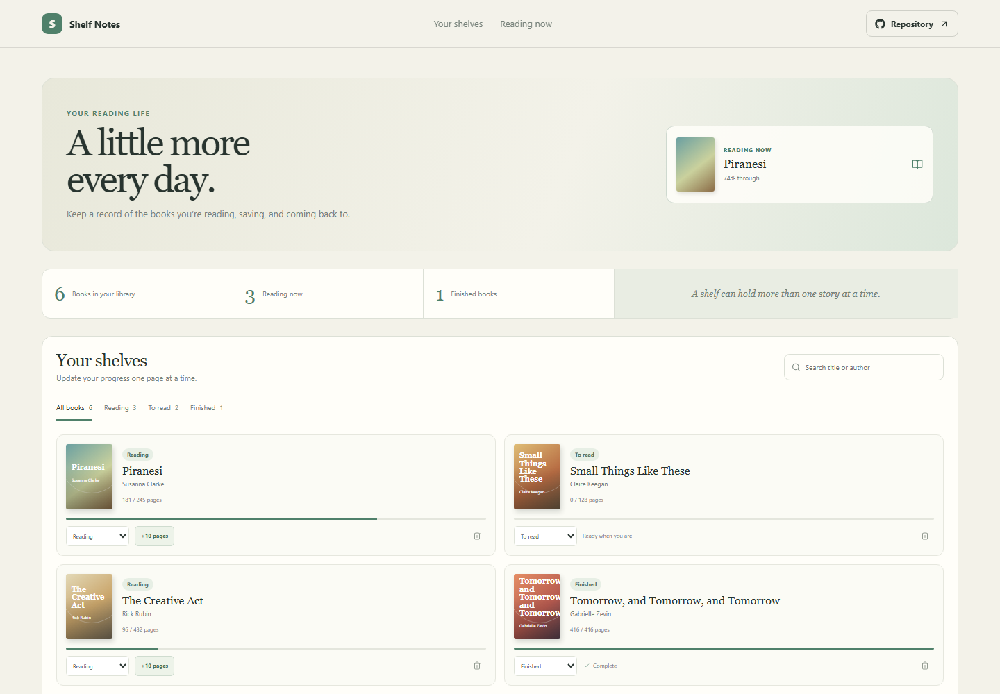

# Personal Book Library

Shelf Notes tracks a personal reading list, current page counts, and finished books without turning reading into a competition.

**Live site:** [https://a2rp.github.io/personal-book-library/](https://a2rp.github.io/personal-book-library/)

## Interface

A reading-now card highlights the first active book. Library totals and shelf tabs sit above a searchable book grid with covers, status, page progress, and per-book actions.

## Features and use

Add a title and author to create a To read entry. Use the shelf tabs or search to find a book. Change its status from the card selector. For a Reading book, select +10 pages to update progress; selecting Finished fills the page count. Remove a book with the trash button and confirm.

## Data and limits

Book details and page progress are saved in localStorage on this device. New books start with an estimated 240 pages; existing sample books include page totals for progress display.

## Run locally

Use Node.js and npm, then run these commands from the project folder:

```sh
npm install
npm run dev
```

Run ESLint and create a production build with:

```sh
npm run lint
npm run build
```

## Deployment

The public app is published with GitHub Pages. Build and publish the current version with:

```sh
npm run deploy
```

Vite builds with the /personal-book-library/ project-page base path.

## Future improvements

These are ideas and are not implemented yet:

- Allow page totals and reading dates to be edited.
- Add personal notes, ratings, and import or export.

## Links

- Portfolio: [https://www.ashishranjan.net](https://www.ashishranjan.net)
- GitHub: [https://github.com/a2rp](https://github.com/a2rp)
- CodePen: [https://codepen.io/ash1198](https://codepen.io/ash1198)
- LinkedIn: [https://www.linkedin.com/in/aashishranjan](https://www.linkedin.com/in/aashishranjan)
- Facebook: [https://www.facebook.com/theash.ashish/](https://www.facebook.com/theash.ashish/)
- YouTube: [https://www.youtube.com/@ashishranjan-ashz?sub_confirmation=1](https://www.youtube.com/@ashishranjan-ashz?sub_confirmation=1)
- Email: [mailto:ash.ranjan09@gmail.com](mailto:ash.ranjan09@gmail.com)

## Support

- Support: [https://a2rp-donation-page.netlify.app/](https://a2rp-donation-page.netlify.app/)
- Buy Me a Coffee: [https://buymeacoffee.com/ashishranjan](https://buymeacoffee.com/ashishranjan)
- Patreon: [https://www.patreon.com/ashishranjan](https://www.patreon.com/ashishranjan)